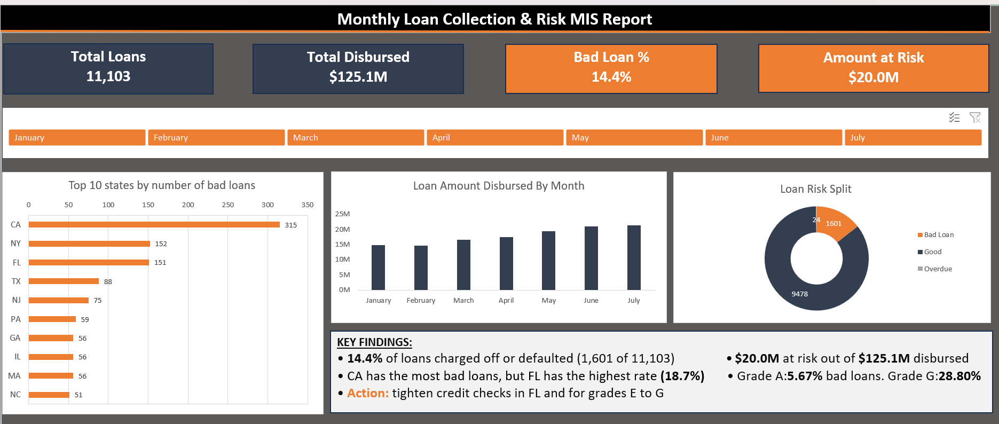

# Monthly Loan Collection & Risk MIS Report

**Excel | Power Query | Pivot Tables | Slicers | Dashboard**

An automated monthly MIS report for a loan portfolio. Monthly loan files go into a folder, Power Query combines and cleans them, and the dashboard updates with one click (**Data > Refresh All**).



## Business problem

A finance company (bank or NBFC) receives loan data as separate files every month. Management needs to know how much was disbursed, how much of it is going bad, and where the risk sits. Rebuilding this report by copy-paste every month is slow and error-prone.

This project automates it: add the new month's file, click Refresh, and the report updates.

## Dataset

- **Source:** Lending Club loan data (`loan_data_2007_2014.csv`, from Kaggle)
- **Used:** loans issued in 2011, with 16 of the 75 columns kept
- **Report period:** January to July 2011 (11,103 loans)
- The data is public US data and is used to practise the MIS reporting process. It is not a real company's report.

## What the project does

- Combines monthly CSV files from a folder into one clean table using **Power Query (From Folder)**
- Adds a **Month Name** column and a **Loan Risk** column (Good, Overdue, Bad Loan)
- Summarises the data with **pivot tables** (by month, risk, state and grade)
- Shows a one-page **dashboard** with KPI cards, a month slicer, charts and key findings
- Updates automatically when a new month's file is added to the folder

## Repository contents

| Item | Description |
|---|---|
| `Loan_MIS_Report.xlsx` | The report workbook (Power Query, pivots, KPI formulas, dashboard) |
| `Raw_Data/` | Monthly loan files, January to June 2011 |
| `New_Month/` | `Loan_JUL_2011.csv`, the file used to test the refresh |
| `images/` | Dashboard screenshot |
| `Loan_MIS_Refresh_Demo.mp4` | 55-second screen recording of adding July and clicking Refresh All |

## How it works

1. **Prepared the data:** loaded the original CSV through Power Query, kept 16 columns, and filtered to 2011.
2. **Created monthly files:** split the 2011 data into one CSV per month to copy how a company receives data.
3. **Combined the files:** Data > Get Data > From File > From Folder > Combine & Transform Data.
4. **Added `Month Name`:** Add Column > Date > Month > Name of Month.
5. **Added `Loan Risk`** with a Conditional Column:
   - `loan_status` contains "Charged Off" or "Default": **Bad Loan**
   - `loan_status` contains "Late": **Overdue**
   - Otherwise: **Good**
6. **Built pivot tables:** loan amount by month, risk split, risk by state, risk by grade.
7. **Built the dashboard:** four KPI cards, a month slicer, three charts and key findings.
8. **Tested the refresh:** added `Loan_JUL_2011.csv` to the folder and clicked Refresh All. Total loans moved from 9,228 to 11,103.

## KPI formulas

```
Total Loans      =COUNTA(Raw_Data[id])
Total Disbursed  =SUM(Raw_Data[loan_amnt])
Bad Loan %       =COUNTIF(Raw_Data[Loan Risk],"Bad Loan")/COUNTA(Raw_Data[id])
Amount at Risk   =SUMIFS(Raw_Data[loan_amnt],Raw_Data[Loan Risk],"<>Good")
```

## Key findings

- **11,103 loans** and **$125.1M** disbursed (January to July 2011).
- **14.4%** of loans were charged off or defaulted (1,601 loans), about **$20.0M** at risk.
- **Grade A** loans have 5.67% bad loans, while **grade G** loans have 28.80%.
- **CA** has the most bad loans (315 of 1,920 loans, a 16.41% rate), because it has the most loans.
- **FL** has the highest bad loan rate among large states (151 of 809 loans, 18.67%).
- Overdue loans are only about 0.2%, so most of the risk is loans that are already charged off.

## Recommendations

1. Tighten credit checks and lower loan limits for **grades E to G**.
2. Apply stricter approval checks for **FL** applications.
3. Follow up on **Late** loans early, before they reach Charged Off.

## Demo

Refresh demo (adding July and clicking Refresh All):

https://github.com/user-attachments/assets/e4373a1c-1357-4e44-a410-ec7bc66933b8

## How to use

1. Download this repository.
2. Open `Loan_MIS_Report.xlsx`.
3. The Power Query source points to the `Raw_Data` folder on the original computer. To use it on yours, go to **Data > Queries & Connections**, double-click **Raw_Data**, open **Applied Steps > Source**, and change the folder path to your copy of `Raw_Data`.
4. Copy `New_Month/Loan_JUL_2011.csv` into `Raw_Data` and click **Data > Refresh All**.

New files must be CSV files with the same column names as the existing ones.

## Limitations

- Public US data from 2011, used to practise the reporting process.
- The key findings text is written by hand. The KPI cards, pivots and charts refresh automatically.
- The KPI cards show totals for all months and do not follow the month slicer.
- Amount at Risk uses the original loan amount, so it is exposure and not actual loss.

## Author

**Arlin Soniya** | Chennai
[LinkedIn](https://linkedin.com/in/arlin-soniya29) | [GitHub](https://github.com/arlin-soniya)
